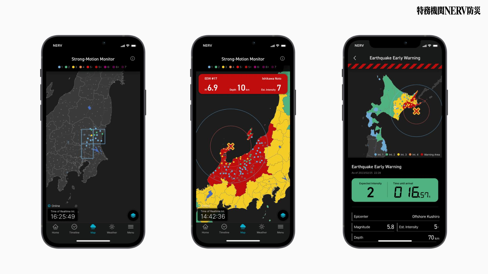
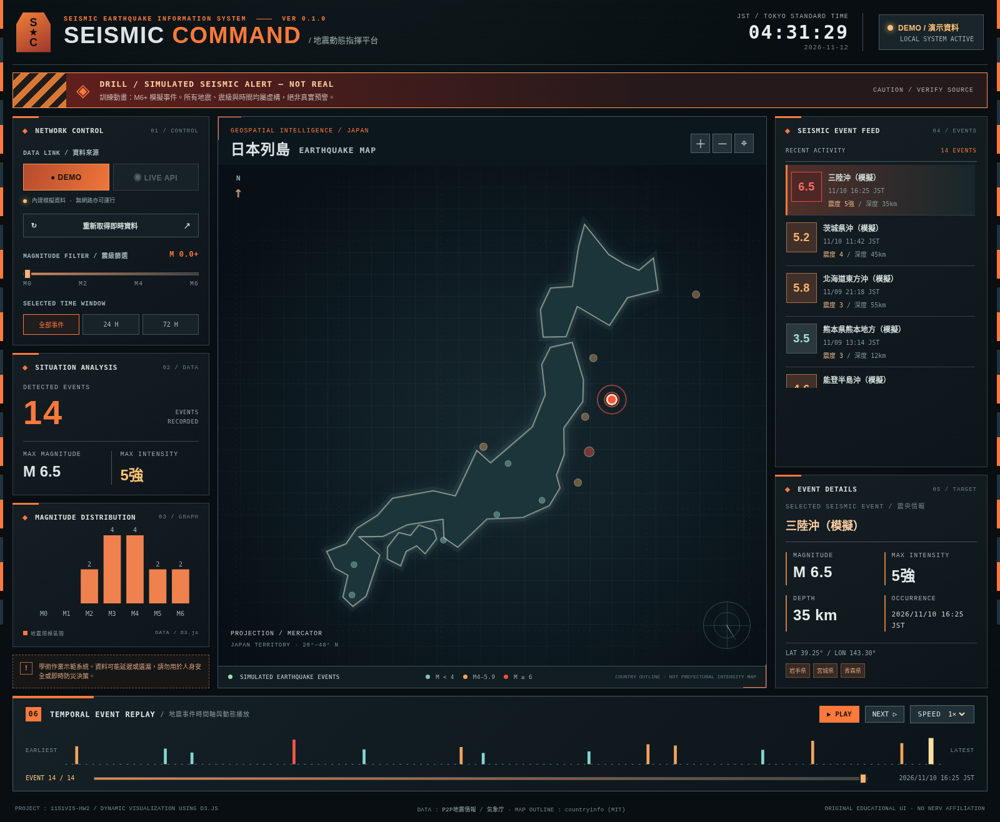
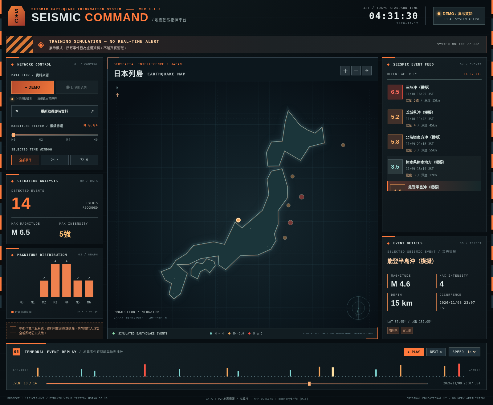
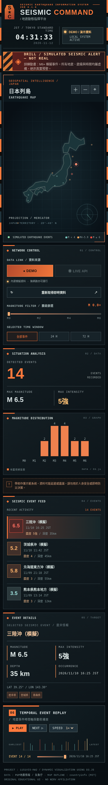

https://github.com/s051692011/1151VIS-HW2-414085181
414085181 HW2: Dynamic visualization using D3.js

參考 : Nerv防災特務機關 APP
使用Eva style主題 並將Nerv防災特務機關 APP 中的主要視覺資料呈現與功能在頁面上使用監控儀表板的方式再現

- APP功能參考：


- 實作頁面截圖：





製作流程
1. 資料選題：採用 P2P地震情報公開 API，可取得日本地震規模、震度、時間、經緯度等資料。
2. 資料處理：以 `fetch` 取得 JSON，使用 WebSocket 監看新增事件，驗證經緯度與資料格式，依 ID 去重。
3. 動態視覺化：採用 D3.js 的 Mercator 地理投影、SVG 地圖標記、過渡動畫、震級統計長條圖及時間軸。
4. 互動功能：實作事件點選、地圖縮放與拖曳、震級篩選、時間區間與自動播放。
5. 本地模式：將 D3.js 與簡化日本地圖資源包含在專案內；離線時使用明確標示的虛構資料。
6. 網頁部署：以 `start.bat` 配合 Python HTTP Server 在本地執行；上傳至 GitHub Pages 時僅需 HTML/CSS/JS。


部屬:
- 雙擊 `start.bat`，在瀏覽器開啟 `http://127.0.0.1:8000/`。
- 點 `DEMO` 以重播模擬地震資料；若有網路可點 `LIVE API` 嘗試接收真實資料。
- 拖曳日本地圖或點 + / − 放大縮小，點選地震事件查看細節。
- 調整 `MAGNITUDE FILTER`，觀察地震位置及統計圖同步變化。
- 用底部 `PLAY`、`NEXT`、`SPEED` 和時間軸滑桿播放事件時間序列。

架構:
```text
P2P JSON API (history / jma/quake)  ────┐
P2P WebSocket (/ws)                 ────┤
                                        ▼
                         js/earthquake-api.js
                         解析 551 地震事件與 556 EEW
                         驗證座標、震級、日期、事件ID
                                        │
              DEMO_QUAKES（離線） ────────┤
                                        ▼
                                 js/app.js
                  filters / selected / replay / de-dupe
                           │           │            │
                           ▼           ▼            ▼
                       D3.js map   D3.js bar   D3.js timeline
                           └───────── DOM panels ──────┘
                                        ▼
                          index.html + eva-theme.css
```


資料來源與制限:
- P2P地震情報：<https://www.p2pquake.net/develop/json_api_v2/>
- 日本氣象廳：<https://www.jma.go.jp/jma/index.html>
- D3.js：<https://d3js.org/>
- 本地地圖：簡化日本國界

聲明：此為課程教學作品，不是官方地震速報系統，亦非 NERV 官方應用。DEMO 事件均為模擬資料。

